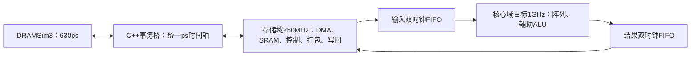

> 历史记录：以下内容属于迁移前 Nangate45 / 多流水配置。当前仅支持 ASAP7 F2；请以 README.md、MIGRATION_ASAP7.md 和本轮冻结验收报告为准。

# 数值、功能覆盖与访存验证

本工程采用“已声明功能覆盖点≥99%，关键点100%，数值零错误”的门槛。
它度量有限验证模型，不表示任意输入正确性的概率。STA 的 `coverage_clean`
仅表示时序覆盖检查；代码覆盖另行实测，不设99%门槛。

## 固定源码集合与完整回归

```bash
python3 scripts/run_verification_cohort.py \
  --out artifacts/verification27/cohort_final --workers 2 --jobs 4
```

首次运行冻结 `cohort.json` 及 `sources/` 中的完整源码内容，后续每步前后校验源码和工艺库。目录已存在时
可以用同一命令继续；完整通过的配置检查报告哈希后跳过，失败重试保留新
`attempt_*` 目录。修改被冻结的源码后应选择新输出目录，禁止改写旧集合。
同一输出目录只能有一个活动回归驱动；恢复前先确认旧驱动已退出，避免
两个进程覆盖进度或并发重建同一目标。
构建标签从集合哈希产生，各目标、流水、尺寸和覆盖版本分别保留。

默认覆盖 F2/HF8/HF12 各自的 PE、2×2、8×8 和 8×8 自主 GEMM。
`progress.json` 是运行状态；各配置的 `configuration_model.json` 在测试前
固定，`functional_coverage.json` 保留命中、首个观察见证、未命中和失败。
完整配置（包括必需场景）的逐点CSV和哈希索引见
`artifacts/verification27/coverage_tables_v2/index.json`。其中 `hits` 直接保留父模型
的验证记录计数，`numerical_observation_hits` 单独保留数值子集中实际检查的RTL
响应次数；父模型导入子集覆盖时只保留验证见证，不能将其计数解释为全部响应总数。
适用点及排除规则都来自测试前冻结的模型，功能百分比以命中点数为分子。
数值子集通过不会提前使完整配置通过；完整结论还要求依赖、状态、复位、
II、长K、矩阵、时钟/存储和代码覆盖一致性等适用检查全部通过。

同一最长K轨迹逐次检查 PE 的所有返回值；阵列在 K=1/7/8/9/65535/65536
处分别排空并读回，再继续原上下文。因此所有边界都有真实观察，不重复
执行同一长前缀，也不改变每个输出的累加顺序。

本轮冻结的无NPZ分组检查每次展开全部五种模式；外层按模式重复调用时，
`artifacts/verification27/resume_campaign.py` 保留已通过配置和步骤，并由
`replay_grouped.py` 检查重新生成的轨迹逐字节相同、仿真器/库/DRAM配置和
时钟身份相同后，重放首份实际日志、重算参考和全部检查。复用步骤写出
`*.reuse.json`，分组指标标记 `fresh_simulation=false`，不新增仿真计数。
辅助调度源码另存于 `cohort_final/orchestration_sources/`，哈希单独绑定；
155个冻结源文件保持不变。`audit_evidence_reuse.py` 另行审计这些关联。

## 单独运行与计数依据

```bash
python3 scripts/check_functional_coverage.py --build-dir BUILD --out RESULT
python3 scripts/build.py --kind pe --stages 12 --hierarchical \
  --label coverage_example --coverage -j 4
python3 scripts/report_code_coverage.py RESULT/coverage.dat \
  --build-dir COVERAGE_BUILD --out RESULT/code_coverage.json
python3 scripts/check_cdc_matrix.py --out artifacts/cdc_matrix -j 4
```

`check_functional_coverage.py` 逐项对照精确整数/有理数模型，检查实际响应，
按 tag、格式、操作、上下文、PE位置、有效通道和输入编码归属覆盖点。
单PE另检查实际接收和返回上下文事件；阵列另核对独立波前周期和事件计数。
结果保存 JSON、逐覆盖点CSV、输入轨迹、原始日志及检查器/参考模型快照。

INT4 包含每通道256种输入对和全16通道并行激励；浮点包含RNE中点、
次正规数、抵消、正负零和适用异常。FP4有限源编码没有输入NaN/Inf，
但其FP32累加器的NaN仍适用。没有除法，DZ不作为可命中事件；FP4/8/16
扩大到FP32累加时，有限源的OF/UF适用范围不能照搬原输入格式。

`sim/pe_main.cpp` 的普通8字段请求保持兼容。定向检查还可以在请求后附加
`expected_value expected_flags seed_value seed_flags`，由测试桥先排空并
写入真实seed端口，再发起该操作。参考结果只用于检查，不接入DUT运算数据。

代码覆盖构建启用实际Verilator行、表达式和翻转计数。每次运行由环境变量
`SIMD_CODE_COVERAGE` 指定独立文件。层级模型必须在 `final()` 删除子模型
之前导出计数。原始数据绑定仿真器、RTL和通过的运行身份后才能汇总。
报告区分自研逻辑、修改后的浮点算术和上游IP，保留未命中项；Verilator
默认合并同类实例计数，功能位置覆盖仍逐PE检查。超过工具宽度限制的信号、
常量优化及表达式计数语义须按报告限制解释，不声称MC/DC或全状态空间证明。
当前代码覆盖采样范围是PE/阵列的定向数值套件及完整系统的smoke套件；
完整功能回归另外执行状态、依赖、复位、长K和存储测试，不能将其运行数量
补算成代码覆盖命中数。
HF12 8×8另提供测试前冻结的101例插桩采样：完整8×8 RTL仍被实例化，定向
观测PE(0,0)，覆盖格式、关键异常、掩码及上下文选择。普通与插桩构建执行
同一采样并逐位、逐事件、逐周期比较。该采样不声称功能覆盖≥99%；完整
功能验收继续使用原始全部PE/通道/上下文及长K/协议回归的固定分母。
原完整插桩尝试保留；只有新采样及独立审计通过后才允许关联其代码报告。
不同采样范围的代码覆盖百分比须结合采样清单解释，不能直接作等强度比较。

`artifacts/verification27/checker_negative_replay_v2/verification.json` 记录了
对已通过日志的离线变异检查：未修改的PE、阵列及GEMM日志先通过原检查器，
再分别注入INT64结果截断到128bit、读回周期加1和删除零值输出字节，三项
均被原检查器拒绝。重放前要求重新生成的激励逐字节等于原轨迹，检查器源码
保持冻结；该检查不表示在DUT中注入了硬件故障，也不重复计为新的RTL仿真。

## 三种节拍及端口

主评估存储周期4000ps（250MHz），3700ps保留作非整数比例压力测试。
核心F2仿真默认10000ps，HF压力测试使用1000ps；均不自动认证物理频率。
当前DRAM运行时为630ps、64bit、BL8：DRAM CK约1.587GHz，DDR数据率约
3174.603MT/s，单通道共享数据总线峰值约25.397GB/s。



读写数据接口各128bit，250MHz下各方向接口容量上限4GB/s。自主GEMM
采用单缓存行gather，实际读在途上限1，写DMA在途上限1；独立ReadDma
模块的32个读信用不能当作该控制器的实际并发。缓冲A/B/C为16/32/16KiB，
各自逻辑1R1W×128bit，另有64KiB、1R1W×64bit汇总状态；仲裁限制并发。

新仿真日志的 `K` 来自DRAM运行时API，`PORTS` 来自实际握手，记录在途
峰值和读写数据拍数，并核对每个64B事务对应4个128bit数据拍。报告分别
保存有用字节、接口字节、实际DRAM突发字节，posted完成与最终排空时间。
历史日志没有这些观察时明确标为未观察，不替换其原始频率或补造数据。

所有新构建输出格式/乘积/累加位宽及逻辑接口清单。INT4为16条独立整数
通路；FP4当前为16条精确展开后的FP32 FMA通路。INT32为2×80bit累加，
INT64为1×144bit累加；统一512bit结果容器保留有效宽结果，原生输出每元素
分别10B/18B。当前工艺为Nangate45 typical（1.10V、25℃），标准单元存储，
没有ASAP7/7nm工艺或SRAM宏。

## 验证范围

数字FIFO频率比、相位、满空、回绕和复位检查不替代Gray偏斜、FIFO数据
路径、MTBF及复位释放物理签核。零延迟门级数值检查不替代提取后STA。
完整硬件计划、完整PE/阵列1GHz及物理CDC始终独立验收。
